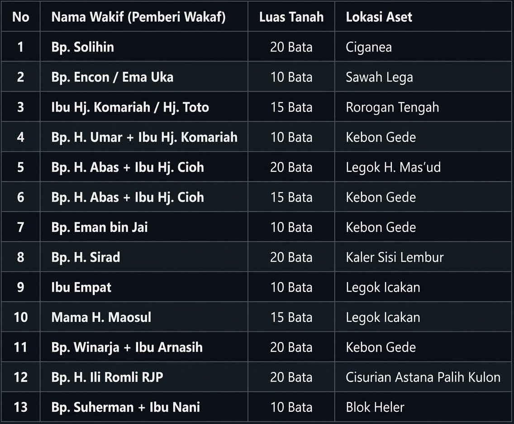

# 🕌 Portal Transparansi Keuangan & Aset Wakaf
### Dewan Kemakmuran Masjid (DKM) Masjid Jamie Al-Istiqomah

Selamat datang di portal resmi **Sistem Informasi Keuangan dan Aset Wakaf** **Masjid Jamie Al-Istiqomah**. Layanan digital ini dihadirkan sebagai wujud komitmen pengurus DKM dalam menjaga amanah umat melalui tata kelola keuangan (Kas Jum'at, Keuangan Wakaf, dan Dana Kematian) serta pendataan aset wakaf yang transparan, akuntabel, dan mudah diakses oleh seluruh jamaah.

---

## 📍 Profil & Identitas Masjid
* **Nama Masjid:** Masjid Jamie Al-Istiqomah
* **Lembaga Pengelola:** Dewan Kemakmuran Masjid (DKM) Masjid Jamie Al-Istiqomah
* **Alamat Sekretariat:** Kp. Karangiyuh, Jl. Cisurian–Cihateup, Desa Rajamandala, Kec. Rajapolah, Kab. Tasikmalaya, Jawa Barat

---

## 📜 Daftar Aset Tanah Wakaf Masjid 
Berikut adalah rekapitulasi data tanah wakaf yang dikelola dan tercatat secara resmi oleh DKM Masjid Jamie Al-Istiqomah:



> *Total keseluruhan tercatat **13 bidang tanah wakaf** dengan total luas **195 Bata** (dikecualikan kolom pengelola/pemegang dan rincian hasil panen untuk menjaga privasi dan fokus pada arsip aset).*

---

## 📊 Cakupan Laporan Keuangan Portal
Portal ini menyajikan tiga pilar pencatatan keuangan masjid secara terpisah agar mudah diaudit oleh jamaah:
1. **🕌 Kas Jum'at:** Pencatatan infak kotak amal mingguan dan pengeluaran operasional rutin masjid.
2. **📜 Keuangan Wakaf:** Pengelolaan dana hasil produktivitas aset wakaf maupun wakaf tunai.
3. **🤲 Keuangan Kematian:** Pencatatan iuran dan santunan dana sosial kemasyarakatan/kematian warga.

---

## ✨ Fitur Utama Portal Digital
* **📊 Ringkasan Saldo Otomatis:** Menampilkan Saldo Awal, Total Pemasukan, Total Pengeluaran, dan Saldo Akhir secara akurat.
* **🗂️ Arsip Lembar Terstruktur:** Memudahkan penelusuran riwayat laporan per lembar atau periode pencatatan.
* **🔍 Pencarian Cepat:** Filter transaksi secara instan berdasarkan kata kunci uraian maupun tanggal.
* **📥 Ekspor Excel (CSV) & Cetak PDF:** Mendukung pengunduhan data ke format spreadsheet serta tata letak siap cetak (A4) lengkap dengan kolom pengesahan DKM.

---

## 📂 Struktur Repositori Sistem
```text
Kas-Masjid/
├── index.html              # Antarmuka utama portal web (4 menu navigasi)
├── README.md               # Dokumentasi resmi & daftar aset wakaf
├── data-kematian.json      # Data pencatatan keuangan dana kematian
├── data-kas/               # Direktori arsip Kas Jum'at (daftar.json & lembar-X.json)
└── data-wakaf/             # Direktori arsip Keuangan Wakaf (daftar.json & wakaf-X.json)
```

---

## 🤝 Layanan Informasi & Konfirmasi Jamaah
Apabila terdapat kekeliruan penulisan nama wakif, luas tanah, lokasi, maupun pertanyaan terkait laporan keuangan, jamaah atau ahli waris dapat menghubungi pengurus **DKM Masjid Jamie Al-Istiqomah** secara langsung di sekretariat masjid.

> *"Sesungguhnya yang memakmurkan masjid-masjid Allah hanyalah orang-orang yang beriman kepada Allah dan hari kemudian, serta tetap mendirikan shalat, menunaikan zakat dan tidak takut (kepada siapa pun) selain kepada Allah..."* **(QS. At-Taubah: 18)**

---
*Dokumen digital ini dikelola secara resmi oleh Pengurus DKM Masjid Jamie Al-Istiqomah — Rajapolah, Tasikmalaya.*
